# MPC UI Reference Screenshot Index

Repository-local visual reference gallery for MPC UI reconstruction. Full-page PDF images preserve the page caption and context; large raster figure crops are stored beside each source page where detected.

- images/: downloaded copies of image URLs cited in the catalog and related knowledge-base docs.
- pdf/<source>/page-NNN.jpg: page render from the cited manual.
- pdf/<source>/figures/: large image regions cropped from relevant PDF pages.
- manifest.json: source URL, local path, file hash/size, extraction status and failures.
- These documentation references are not packaged into the Android app.

**Inventory:** 59 image URLs; 59 downloaded; 0 failed; 96 PDF pages rendered; 126 figure crops.

## Screen and sub-screen gallery

### VIS-001 — Main overview: Sequence + Track/Arrangement

**Evidence:** Inline A/B images

**Stored page:** mpc-v39, printed PDF page 15.

### VIS-002 — Toolbar / project / counter / transport

**Evidence:** Inline Main images A/B

No linked PDF page render was associated with this row. Check the source-image manifest for available images and download/render failures.

### VIS-003 — Pull-Down Menu / status controls

**Evidence:** Official guide reference

No linked PDF page render was associated with this row. Check the source-image manifest for available images and download/render failures.

### VIS-004 — Five shortcut rail

**Evidence:** Inline Main/XL images A

No linked PDF page render was associated with this row. Check the source-image manifest for available images and download/render failures.

### VIS-005 — XL Channel Strip, Main context

**Evidence:** Inline A

**Stored page:** mpc-v39, printed PDF page 20.

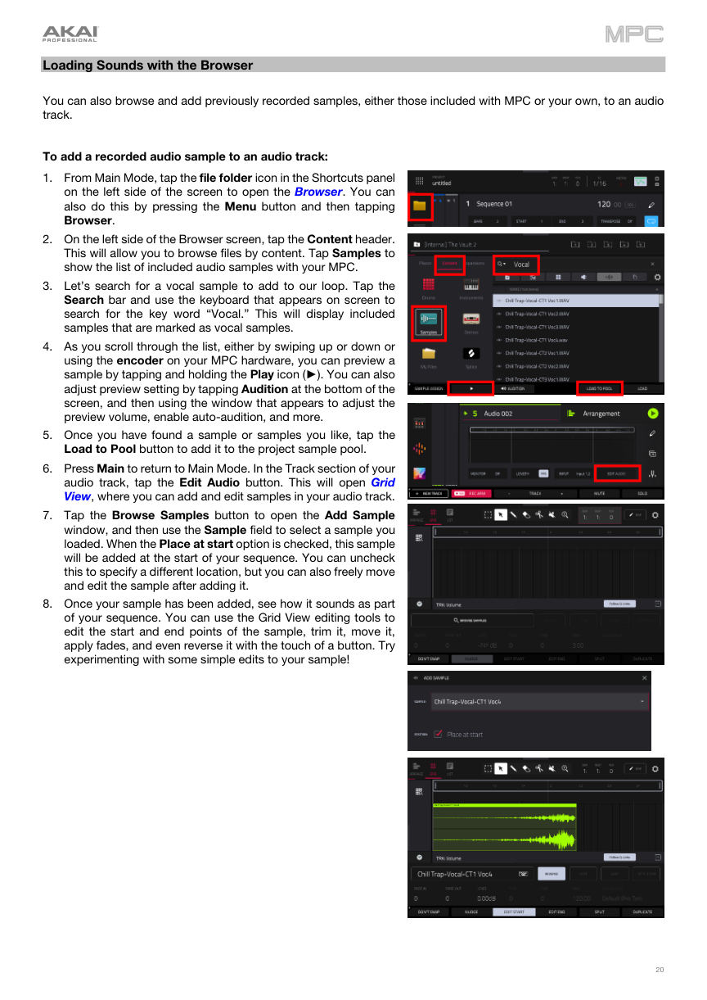

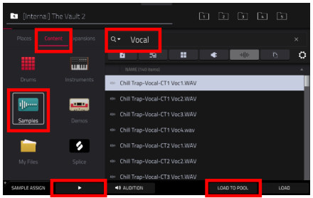

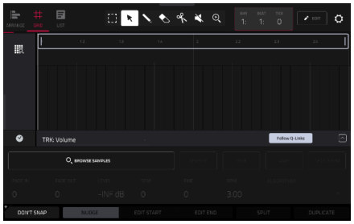

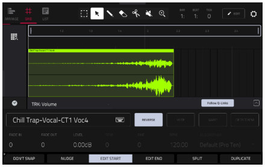

### VIS-006 — XL Channel Strip — I/O / output chooser

**Evidence:** Inline A

**Stored page:** mpc-v39, printed PDF page 20.

### VIS-007 — Menu / mode launcher

**Evidence:** Inline B; additional mode-tile overview

**Stored page:** mpc-v39, printed PDF page 20.

### VIS-008 — Browser — Places

**Evidence:** Inline A

No linked PDF page render was associated with this row. Check the source-image manifest for available images and download/render failures.

### VIS-009 — Browser — Content

**Evidence:** Inline A

No linked PDF page render was associated with this row. Check the source-image manifest for available images and download/render failures.

### VIS-010 — Browser — Expansions

**Evidence:** Inline A

No linked PDF page render was associated with this row. Check the source-image manifest for available images and download/render failures.

### VIS-011 — Browser — Sample Assign / Sample Pool

**Evidence:** Inline A

**Stored page:** mpc-v39, printed PDF page 21.

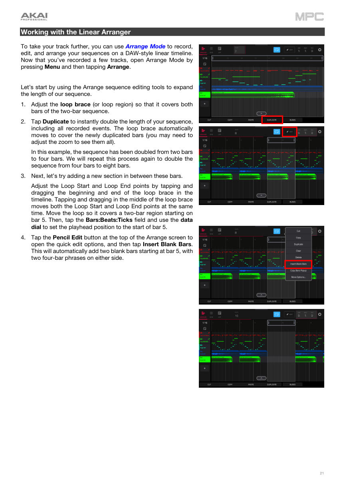

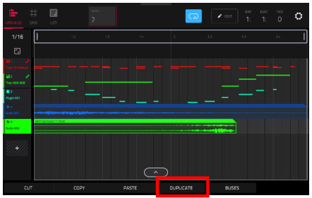

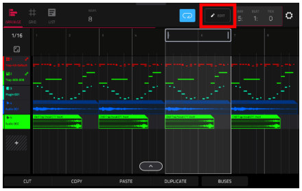

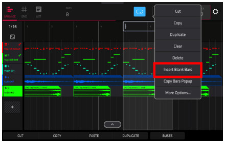

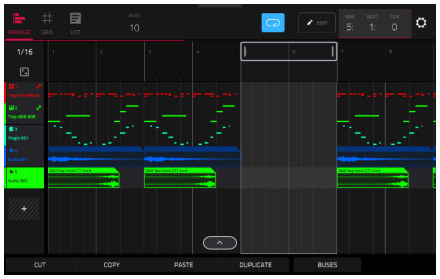

### VIS-012 — Browser — Options / filters / favourites / audition

**Evidence:** Inline Options; current audition/filter/favourites details in §8.26

**Stored page:** mpc-v39, printed PDF page 136.

### VIS-013 — Main Sequence Select / sequence fields

**Evidence:** Inline Main A/B

**Stored page:** mpc-v39, printed PDF page 29.

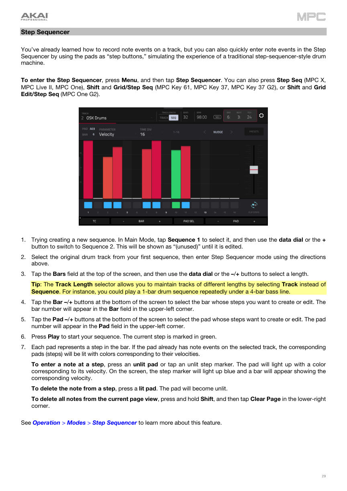

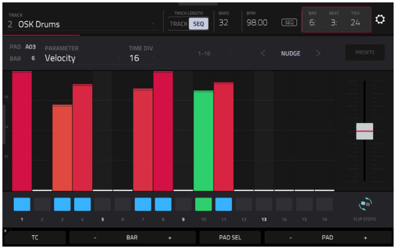

### VIS-014 — Main Track fields / Program Select

**Evidence:** Inline Main + official Program article

No linked PDF page render was associated with this row. Check the source-image manifest for available images and download/render failures.

### VIS-015 — Main Track sample / waveform / layer context

**Evidence:** Inline Main A

No linked PDF page render was associated with this row. Check the source-image manifest for available images and download/render failures.

### VIS-016 — Main Arrangement preview / switch

**Evidence:** Inline Main A and MPC 3-family B

No linked PDF page render was associated with this row. Check the source-image manifest for available images and download/render failures.

### VIS-017 — Track View overview / I/O / Monitor

**Evidence:** Inline official A (older appearance)

**Stored page:** mpc-v39, printed PDF page 45.

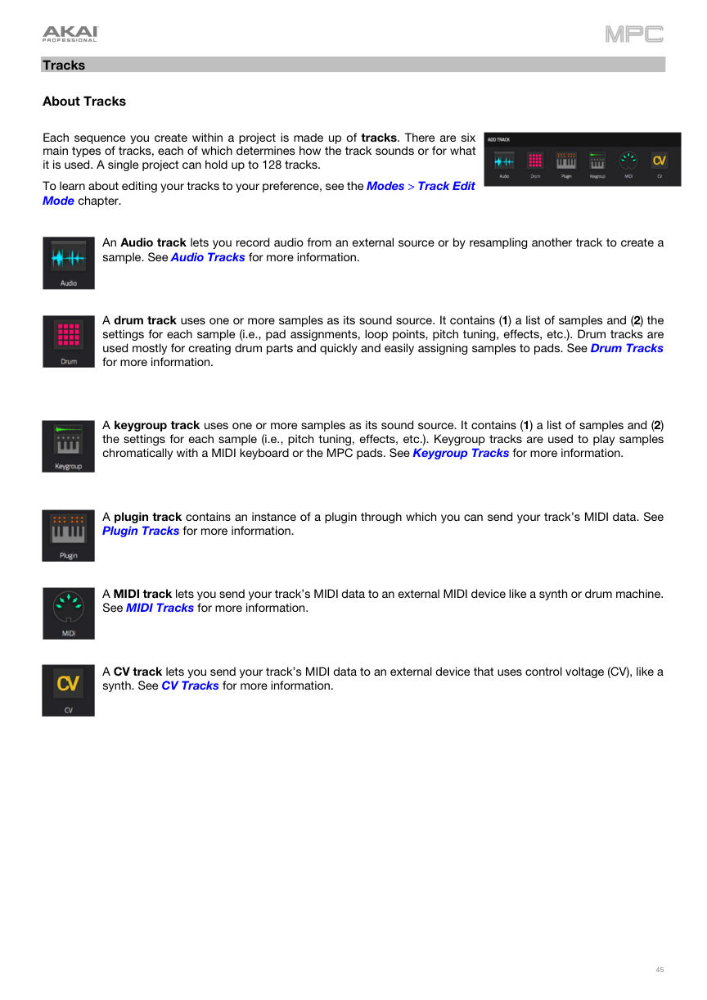

### VIS-018 — Track View — group / track states

**Evidence:** Official manual link

No linked PDF page render was associated with this row. Check the source-image manifest for available images and download/render failures.

### VIS-019 — Arrangement — timeline / loop / playhead

**Evidence:** Inline Main A and sibling MPC 3 B

No linked PDF page render was associated with this row. Check the source-image manifest for available images and download/render failures.

### VIS-020 — Arrangement — editing placements / event menu

**Evidence:** Official guide link + Main preview

No linked PDF page render was associated with this row. Check the source-image manifest for available images and download/render failures.

### VIS-021 — Grid View — Drum track / note editing

**Evidence:** Legacy inline C; current v3.9 figures in §8.25

**Stored page:** mpc-v39, printed PDF page 167.

### VIS-022 — Grid View — Audio track

**Evidence:** Official v3.9 guide link

No linked PDF page render was associated with this row. Check the source-image manifest for available images and download/render failures.

### VIS-023 — Grid View — velocity / automation lanes

**Evidence:** Legacy inline C / Chop visual as related context

No linked PDF page render was associated with this row. Check the source-image manifest for available images and download/render failures.

### VIS-024 — Step Sequencer — 16 steps / velocity

**Evidence:** Inline B, actual One photo (legacy); current v3.9 screenshot figure in §8.25

**Stored page:** mpc-v39, printed PDF page 179.

### VIS-025 — Step Sequencer — step automation

**Evidence:** Official v3.9 guide link

**Stored page:** mpc-v39, printed PDF page 29.

### VIS-026 — List Edit — Events table

**Evidence:** Current v3.9 figure in §8.25; v3.7 is historical fallback

**Stored page:** mpc-v39, printed PDF page 184.

### VIS-027 — List Edit — Tempo events

**Evidence:** Official manual link

No linked PDF page render was associated with this row. Check the source-image manifest for available images and download/render failures.

### VIS-028 — Track Edit — Drum / Global

**Evidence:** Official guide + legacy Program Edit example

No linked PDF page render was associated with this row. Check the source-image manifest for available images and download/render failures.

### VIS-029 — Track Edit — Drum / Samples / Layers

**Evidence:** Inline official A + legacy inline C

No linked PDF page render was associated with this row. Check the source-image manifest for available images and download/render failures.

### VIS-030 — Track Edit — Drum / Envelopes

**Evidence:** Official guide + related legacy Program Edit visual

No linked PDF page render was associated with this row. Check the source-image manifest for available images and download/render failures.

### VIS-031 — Track Edit — LFO / Modulations / Effects / Mod Matrix / Utilities

**Evidence:** Current v3.9 LFO figure on p.212; other tabs remain separate contexts

**Stored page:** mpc-v39, printed PDF page 212.

### VIS-032 — Track Edit — Keygroup

**Evidence:** Official v3.9 guide link

No linked PDF page render was associated with this row. Check the source-image manifest for available images and download/render failures.

### VIS-033 — Track Edit — Plugin

**Evidence:** Official Program article / v3.9 guide

No linked PDF page render was associated with this row. Check the source-image manifest for available images and download/render failures.

### VIS-034 — Track Edit — MIDI

**Evidence:** Official v3.9 guide link

No linked PDF page render was associated with this row. Check the source-image manifest for available images and download/render failures.

### VIS-035 — Track Edit — CV

**Evidence:** Official v3.9 guide link

No linked PDF page render was associated with this row. Check the source-image manifest for available images and download/render failures.

### VIS-036 — Sample Edit — Trim / region / loop

**Evidence:** Inline B/C

**Stored page:** mpc-v39, printed PDF page 36.

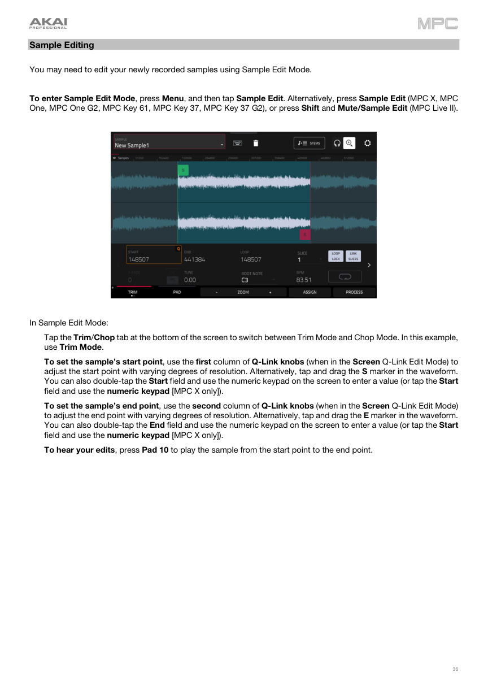

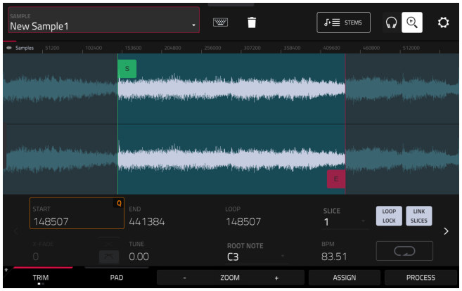

### VIS-037 — Sample Edit — Chop / slice / threshold

**Evidence:** Inline C

No linked PDF page render was associated with this row. Check the source-image manifest for available images and download/render failures.

### VIS-038 — Sample Edit — Pad mode / assignments

**Evidence:** Official manual link + actual One trim photo

No linked PDF page render was associated with this row. Check the source-image manifest for available images and download/render failures.

### VIS-039 — Sampler — record / waiting for signal

**Evidence:** Inline C

No linked PDF page render was associated with this row. Check the source-image manifest for available images and download/render failures.

### VIS-040 — Sampler — Slice

**Evidence:** Official v3.9 guide link

No linked PDF page render was associated with this row. Check the source-image manifest for available images and download/render failures.

### VIS-041 — Sampler — Pad Tap

**Evidence:** Official v3.9 guide link

No linked PDF page render was associated with this row. Check the source-image manifest for available images and download/render failures.

### VIS-042 — Sampler — Pad Hold

**Evidence:** Official v3.9 guide link

No linked PDF page render was associated with this row. Check the source-image manifest for available images and download/render failures.

### VIS-043 — Sampler — Auto Sampler

**Evidence:** Current v3.9 control-detail figures p.304–305 in §8.25

**Stored page:** mpc-v39, printed PDF page 304.

### VIS-044 — Channel Mixer — Volume / Pan & Volume

**Evidence:** Inline official MPC 3 A

No linked PDF page render was associated with this row. Check the source-image manifest for available images and download/render failures.

### VIS-045 — Channel Mixer — Sends

**Evidence:** Inline official MPC 3 A

No linked PDF page render was associated with this row. Check the source-image manifest for available images and download/render failures.

### VIS-046 — Channel Mixer — Effects

**Evidence:** Inline official MPC 3 A

No linked PDF page render was associated with this row. Check the source-image manifest for available images and download/render failures.

### VIS-047 — Channel Mixer — I/O / Monitoring / Route

**Evidence:** Inline official MPC 3 A

No linked PDF page render was associated with this row. Check the source-image manifest for available images and download/render failures.

### VIS-048 — Pad Mixer — Volume / Pan & Volume

**Evidence:** Inline legacy routing image; current v3.9 full-screen and tabs in §8.25

**Stored page:** mpc-v39, printed PDF page 145.

**Stored page:** mpc-v39, printed PDF page 146.

### VIS-049 — Pad Mixer — Sends / Effects / I/O

**Evidence:** Inline C (older routing)

No linked PDF page render was associated with this row. Check the source-image manifest for available images and download/render failures.

### VIS-050 — 16 Levels — Velocity / Tune / Filter / Layer / etc.

**Evidence:** Current v3.9 dialog figures in §8.25

**Stored page:** mpc-v39, printed PDF page 80.

### VIS-051 — Pad Perform — Notes / Chords / Chromatic Chords / Progressions / Custom

**Evidence:** Inline official A + inline legacy C

**Stored page:** mpc-v39, printed PDF page 38.

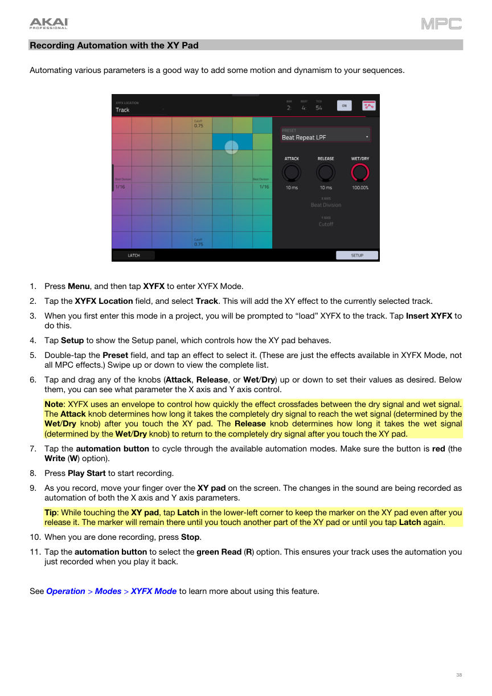

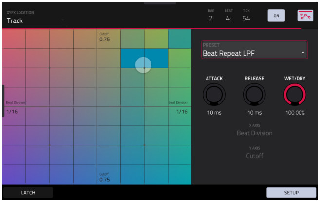

### VIS-052 — Arpeggiator

**Evidence:** Current v3.9 dialog figure in §8.25; supplemental official support image above

**Stored page:** mpc-v39, printed PDF page 84.

### VIS-053 — Erase context/dialog

**Evidence:** Current v3.9 Erase dialog figure in §8.25 plus official Sequence Edit screenshots in §8.22

**Stored page:** mpc-v39, printed PDF page 87.

### VIS-054 — Next Sequence — sequence pad map / Next Bar / Sudden / Hold

**Evidence:** Inline B actual One photo with overlay + official guide link

No linked PDF page render was associated with this row. Check the source-image manifest for available images and download/render failures.

### VIS-055 — Song Mode — playlist and sequence pads

**Evidence:** Inline C

No linked PDF page render was associated with this row. Check the source-image manifest for available images and download/render failures.

### VIS-056 — Looper — waveform / Play / Overdub / Replace / Export

**Evidence:** Current v3.9 Looper figure in §8.25; v3.7 reference historical fallback

**Stored page:** mpc-v39, printed PDF page 340.

### VIS-057 — XYFX — XY plane / destination / latch

**Evidence:** Inline B, MPC Live

No linked PDF page render was associated with this row. Check the source-image manifest for available images and download/render failures.

### VIS-058 — Q-Link Edit — learn / edit assignment

**Evidence:** Inline legacy Q-Link overview + official guide link

No linked PDF page render was associated with this row. Check the source-image manifest for available images and download/render failures.

### VIS-059 — XY Pad / Crossfader

**Evidence:** Inline XYFX visual as related context; official guide link

No linked PDF page render was associated with this row. Check the source-image manifest for available images and download/render failures.

### VIS-060 — MIDI Control Mode — pads

**Evidence:** Official v3.9 guide link

No linked PDF page render was associated with this row. Check the source-image manifest for available images and download/render failures.

### VIS-061 — MIDI Control Mode — buttons

**Evidence:** Official v3.9 guide link

No linked PDF page render was associated with this row. Check the source-image manifest for available images and download/render failures.

### VIS-062 — MIDI Control Mode — Q-Link knobs / XY Pad

**Evidence:** Official v3.9 guide link

No linked PDF page render was associated with this row. Check the source-image manifest for available images and download/render failures.

### VIS-063 — Pad Color / pad mapping

**Evidence:** Inline B actual One photo + legacy pad-map table

No linked PDF page render was associated with this row. Check the source-image manifest for available images and download/render failures.

### VIS-064 — Sounds Mode — Favourites / Setlists

**Evidence:** Official v3.9 guide link

No linked PDF page render was associated with this row. Check the source-image manifest for available images and download/render failures.

### VIS-065 — Project — New Project / Open / Save / Save As

**Evidence:** Inline legacy Save modal and Project Load/Save preferences

**Stored page:** mpc-v39, printed PDF page 60.

### VIS-066 — Save Window — project / project as / export formats

**Evidence:** Inline C legacy image; current guide Save Window figure on p.69 in §8.25

**Stored page:** mpc-v39, printed PDF page 69.

### VIS-067 — Preferences — Audio Device

**Evidence:** Official v3.9 guide link

**Stored page:** mpc-v39, printed PDF page 62.

### VIS-068 — Preferences — Audio / Export

**Evidence:** Official v3.9 guide link

**Stored page:** mpc-v39, printed PDF page 63.

### VIS-069 — Preferences — MIDI / Sync

**Evidence:** Actual One photo plus current-generation official Akai image in §8.26

**Stored page:** mpc-v39, printed PDF page 63.

### VIS-070 — Preferences — Hardware

**Evidence:** Official Akai Hardware Preferences image in §8.23; current guide p.64 text

**Stored page:** mpc-v39, printed PDF page 64.

### VIS-071 — Preferences — Sequencer

**Evidence:** Official v3.9 guide link

**Stored page:** mpc-v39, printed PDF page 65.

### VIS-072 — Preferences — Project Defaults

**Evidence:** Supplementary screenshot in §8.26; current guide p.66 text

**Stored page:** mpc-v39, printed PDF page 66.

### VIS-073 — Preferences — Project Load/Save

**Evidence:** Official current-generation support images in §8.23 and §8.26; v3.9 guide p.67 text

**Stored page:** mpc-v39, printed PDF page 67.

### VIS-074 — Preferences — General / network / account-related entries

**Evidence:** Official v3.9 guide link

No linked PDF page render was associated with this row. Check the source-image manifest for available images and download/render failures.

### VIS-075 — Timing Correct dialog

**Evidence:** Official v3.9 guide link

No linked PDF page render was associated with this row. Check the source-image manifest for available images and download/render failures.

### VIS-076 — Metronome / Click dialog

**Evidence:** Inline official MPC 3 A

No linked PDF page render was associated with this row. Check the source-image manifest for available images and download/render failures.

### VIS-077 — Automation — Global / Track / Program

**Evidence:** Official guide + inline legacy Q-Link/XY related visual

No linked PDF page render was associated with this row. Check the source-image manifest for available images and download/render failures.

### VIS-078 — Audio Mixdown / export

**Evidence:** Current guide figure on p.100 in §8.25

**Stored page:** mpc-v39, printed PDF page 100.

### VIS-079 — Keyboard Control / Touch Strip

**Evidence:** Official v3.9 guide link

No linked PDF page render was associated with this row. Check the source-image manifest for available images and download/render failures.

### VIS-080 — Project import dialog / Keep-or-Discard / destructive confirmations

**Evidence:** Official v3.9 guide and support links

No linked PDF page render was associated with this row. Check the source-image manifest for available images and download/render failures.

### VIS-081 — Track Type selector / Program-specific Main sections

**Evidence:** Inline Main and Program references

No linked PDF page render was associated with this row. Check the source-image manifest for available images and download/render failures.

### VIS-082 — Dialogs: selectors, numeric entry, routing, effects, picker errors

**Evidence:** Related screenshots above; no single image represents this set

No linked PDF page render was associated with this row. Check the source-image manifest for available images and download/render failures.

## Downloaded direct image references

### MPC 3 Main — sequence, track, arrangement preview and function bar

Source: https://s3.amazonaws.com/cdn.freshdesk.com/data/helpdesk/attachments/production/69176903713/original/tG8Q7SJWSKww5E-BtgLHjff7Z1Y0EL7Jkw.png?1764065208=

### MPC 3-family Main arrangement example on MPC Live III

Source: https://dt7v1i9vyp3mf.cloudfront.net/styles/news_large/s3/imagelibrary/A/AkaiMPCLiveIII_04-ajv0NghfxDb0Qn7EjFNP6tIDITCeULIC.jpg

### MPC 3 XL Channel Strip and I-O routing

Source: https://s3.amazonaws.com/cdn.freshdesk.com/data/helpdesk/attachments/production/69154227724/original/W4p-2vkRxIavIh5ZOK9e8ZvP0fZ0iVPVxA.png?1745834845=

### MPC 3 mode menu

Source: https://www.mpc-tutor.com/assets/mpc-menu-1024x639.png

### Legacy MPC Main screen — comparison only, not MPC 3.9 target

Source: https://dt7v1i9vyp3mf.cloudfront.net/styles/news_large/s3/imagelibrary/M/MPCBasics_02-1eS.kAqGJkEsbEBcA_yfgeJUvXCMWXIi.jpg

### Official MPC Standalone Track View — track rows, monitor, level, mute/solo and Function Bar

Source: https://s3.amazonaws.com/cdn.freshdesk.com/data/helpdesk/attachments/production/69128760784/original/ZxmnIeI0mSiXFQy513lN30sfQ0ai0ObVWg.png?1726736736=

### MPC Browser — Places tab and local storage locations

Source: https://s3.amazonaws.com/cdn.freshdesk.com/data/helpdesk/attachments/production/69177984964/original/iLqdSWSEhgtkBJkc5rRpi5_3L-xx41uWXg.png?1764935456=

### MPC Browser — Content categories

Source: https://s3.amazonaws.com/cdn.freshdesk.com/data/helpdesk/attachments/production/69165719905/original/-BBHK1y9CkqUgmPuiShYZjuXKQpaFT1gFw.png?1754995552=

### MPC Browser — Expansions tab

Source: https://s3.amazonaws.com/cdn.freshdesk.com/data/helpdesk/attachments/production/69165719916/original/LpsBnLwwLU5Antxb5wdSSQK_9pafduji-Q.png?1754995559=

### MPC Browser — Sample Assign and sample pool

Source: https://s3.amazonaws.com/cdn.freshdesk.com/data/helpdesk/attachments/production/69165722181/original/w67qMx9X5NaS3yf3_Efh5FUtSujKqosltQ.png?1754997241=

### MPC Browser Options dialog

Source: https://s3.amazonaws.com/cdn.freshdesk.com/data/helpdesk/attachments/production/69165716730/original/_c1kISWJxQzR99bZd8JmlBS0S0gVwNyBOg.png?1754993450=

### Pad Perform — custom note map and 4×4 pad interpretation

Source: https://s3.amazonaws.com/cdn.freshdesk.com/data/helpdesk/attachments/production/69166324277/original/6NjC6-cRea38vgWsZYANVNmmRnv9QbtgLw.png?1755523845=

### Track Edit — sample layers and waveform

Source: https://s3.amazonaws.com/cdn.freshdesk.com/data/helpdesk/attachments/production/69176903727/original/-0xrv1nhFLQ1XfkWCRFkoCgZQe0zfjr4LA.png?1764065223=

### MPC 3 Sample Edit — waveform, slice and process controls

Source: https://www.mpc-tutor.com/assets/slicemotion/slice05.png

### MPC 3 envelope automation and performance status

Source: https://www.mpc-tutor.com/assets/slicemotion/slice24.png

### Legacy Grid View — note grid with velocity lane; visual structure only

Source: https://s3.amazonaws.com/cdn.freshdesk.com/data/helpdesk/attachments/production/69137425072/original/UbA7URmBzaEGtijRhATbUeKqQJQobByonw.png?1733155392=

### Legacy standalone MPC Sampler recording screen — interaction reference only

Source: https://dt7v1i9vyp3mf.cloudfront.net/styles/news_large/s3/imagelibrary/S/SampleSlicing_02-on3yRqdzNYbySPlbD3x43Dr_yKlI1RKX.jpg

### Preferences — project load/save and autosave

Source: https://www.mpc-tutor.com/assets/autosave.jpg

### MPC One Step Sequencer photographed on the hardware

Source: https://img.youtube.com/vi/uuNyLLg-cXs/maxresdefault.jpg

### MPC waveform Chop mode and slice markers

Source: https://dt7v1i9vyp3mf.cloudfront.net/styles/news_large/s3/imagelibrary/M/MPCBasics_07-NswMBI0X4nQgTah8CIBrwSGbQ5xLHYQO.jpg

### MPC One Next Sequence grid photographed on hardware

Source: https://cdn-ak.f.st-hatena.com/images/fotolife/M/Marronfieldsproduction/20221025/20221025034745.jpg

### MPC Song Mode — sequence playlist and sequence tiles

Source: https://www.mpc-tutor.com/assets/song-mode-playlist-1024x640.png

### MPC 3 Channel Mixer I/O, monitoring, sends and outputs

Source: https://s3.amazonaws.com/cdn.freshdesk.com/data/helpdesk/attachments/production/69192726532/original/_w6tJ-s7R-DyxGc1avFs6s8caU_uAq9B7Q.png?1780034221=

### MPC pad mixer routing matrix — older visual, not MPC 3.9 geometry

Source: https://s3.amazonaws.com/cdn.freshdesk.com/data/helpdesk/attachments/production/69136157082/original/dgGihnRKJXr_dvqLa512k-gmoref-QAe_Q.JPG?1732159501=

### MPC One Preferences — MIDI / Sync ports

Source: https://eu5.dh-cdn.net/uploads/db8181/original/3X/7/3/739f6d1d05b21c98e4cf4c2e8e8a9b23304aaad3.jpeg

### MPC 3 Click/Metro dialog

Source: https://s3.amazonaws.com/cdn.freshdesk.com/data/helpdesk/attachments/production/69183338703/original/C9jY-JC1NZ48_45iDBSAU8uYXQh9eRCcMA.png?1770305858=

### MPC standalone XYFX touch grid

Source: https://heikkisiltala.net/wiki/_media/images/akai_mpc_live/effectsxypad02.jpg?tok=792f2b&w=800

### MPC Program Edit Samples page — layer list

Source: https://www.mpc-tutor.com/assets/prog5.png

### MPC Program Edit — per-pad sample-layer parameters

Source: https://www.mpc-tutor.com/assets/offset2.png

### MPC One pad color / sample assignment grid

Source: https://cdn.mos.cms.futurecdn.net/oC9sLkM9L8r7nj9abQQTsj.jpg

### MPC Q-Link parameter overview

Source: https://www.mpc-tutor.com/assets/qlink-2.png

### MPC Save window — project, project as and other save formats

Source: https://www.mpc-tutor.com/assets/save.png

### MPC One Browser shown on the physical hardware

Source: https://cdn.mos.cms.futurecdn.net/pFYHKeyGe33zd8ypBvFKoi.jpg

### MPC One Sample Edit Trim screen photographed on the hardware

Source: https://cdn-ak.f.st-hatena.com/images/fotolife/M/Marronfieldsproduction/20221028/20221028035306.jpg

### MPC One Sample Assign with sample pool and 4x4 pad assignment

Source: https://assets.st-note.com/img/1714572254880-afLUx6An8g.jpg

### Legacy MPC waveform editor with automation lane and bottom actions

Source: https://ragtime.online/media/catalog/product/6/b/6bc500-crop-af798e-mpcone.jpg.auto.jpg

### MPC Grid with piano-roll events, velocity lane and bottom edit functions

Source: https://s3.amazonaws.com/cdn.freshdesk.com/data/helpdesk/attachments/production/69194801033/original/NcJsWEGW4E8GKzQShSO1Ex2Ek7wkMdv6Cg.png?1782213213=

### MPC Arpeggiator dialog with timing, action, pattern and latch settings

Source: https://s3.amazonaws.com/cdn.freshdesk.com/data/helpdesk/attachments/production/69117558608/original/9s1MRfk1vI0K_6ubpYauxjR2bCN_UBPCSQ.png?1718116566=

### MPC standalone MIDI Sync preferences with input and output ports

Source: https://www.mpc-tutor.com/assets/preferences-midi-incoming-1024x640.png

### MPC 3 Sequence Edit menu with Erase, Clear All, Clear Events, Trim and other sequence operations

Source: https://s3.amazonaws.com/cdn.freshdesk.com/data/helpdesk/attachments/production/69171567821/original/Gn_oosMLkpAb2-Jd4S9CQs8fcCCtzKUJ0g.jpeg?1759738112=

### MPC 3 Erase dialog with sequence, track, time range and event-type options

Source: https://s3.amazonaws.com/cdn.freshdesk.com/data/helpdesk/attachments/production/69171568345/original/y9ooBl_93rautQ01WZCrR0X81Z86U1iGwg.png?1759738577=

### MPC 3 Erase Note mode with the eight-bank pad selection mask

Source: https://s3.amazonaws.com/cdn.freshdesk.com/data/helpdesk/attachments/production/69171568606/original/TKMwaGq0Sqgh2kqcKpJd-Nzu3qgFJw4qaA.png?1759738674=

### MPC 3 Clear Sequence destructive confirmation dialog

Source: https://s3.amazonaws.com/cdn.freshdesk.com/data/helpdesk/attachments/production/69171568002/original/p4XyPOCyXsuXuyqyDqTpVf9cmkKEgnK2jg.png?1759738294=

### MPC 3 Preferences — Hardware tab with Tap Tempo, Bank Button and Q-Link settings

Source: https://s3.amazonaws.com/cdn.freshdesk.com/data/helpdesk/attachments/production/69161763950/original/pWP6-5PdcH9pY2cA4pGmjd4H5xZz47NkEw.png?1751856629=

### MPC 3 Preferences — Project Load/Save tab

Source: https://s3.amazonaws.com/cdn.freshdesk.com/data/helpdesk/attachments/production/69168497633/original/losLbj-hGvLzhujOiTJoGEADHmkCLyMwlw.png?1757329912=

### MPC 3 New Project Behaviour selector

Source: https://s3.amazonaws.com/cdn.freshdesk.com/data/helpdesk/attachments/production/69168497555/original/1B5Ebe8l-fxKf8RUdYXAAru39U1WG5118Q.png?1757329862=

### MPC 3 New Project Dialog selector

Source: https://s3.amazonaws.com/cdn.freshdesk.com/data/helpdesk/attachments/production/69168497526/original/Go4z7ExFaEGKbgu1F2FPTXPQrara8DcZuQ.png?1757329832=

### MPC 3 Main Track Type selector affordance

Source: https://s3.amazonaws.com/cdn.freshdesk.com/data/helpdesk/attachments/production/69135881223/original/OBU4OIPLsVppo0XE-rgOgxdwLUu5JvMD3Q.png?1732016692=

### MPC 3 Main Program context and Pad Perform entry

Source: https://s3.amazonaws.com/cdn.freshdesk.com/data/helpdesk/attachments/production/69135881533/original/Gpm2HcY9ynQCsjxFsSc7T8t0VoLS4_Ldng.png?1732016882=

### MPC Browser with the Audition Auto Sync Warp level popover open

Source: https://s3.amazonaws.com/cdn.freshdesk.com/data/helpdesk/attachments/production/69165715554/original/NWURoLiusABAG6rrubXbuxf-pmUkMGliKw.png?1754992557=

### MPC Browser search and six file-type filter icons

Source: https://s3.amazonaws.com/cdn.freshdesk.com/data/helpdesk/attachments/production/69165715626/original/ZgepHM1fsT3jM9N1rop6oSpx8F81swSJgQ.png?1754992624=

### MPC Browser favourite folder buttons 1 to 5

Source: https://s3.amazonaws.com/cdn.freshdesk.com/data/helpdesk/attachments/production/69165717538/original/03TYqionEXfsV6ARKxTlp1yoNQCUSEZXXQ.png?1754993997=

### MPC 3 Preferences MIDI Sync port routing controls

Source: https://s3.amazonaws.com/cdn.freshdesk.com/data/helpdesk/attachments/production/69151187913/original/qUWciG6cOb30KJXSUof5XWV_BAkPclk0yA.png?1743505244=

### MPC Standalone Sampler screen with input source, Arm, sample counter and Sample Slice Pad Tap Pad Hold tabs

Source: https://s3.amazonaws.com/cdn.freshdesk.com/data/helpdesk/attachments/production/69075163375/original/tP8Gznhoc4AujoPV18pa0M4lGw_Fi4F1pQ.png?1683839460=

### Akai MPC Sampler input-source and Monitor On Off controls

Source: https://s3.amazonaws.com/cdn.freshdesk.com/data/helpdesk/attachments/production/69075165589/original/YFSMdgWyQKiv9I98J_Jl4nbGEHYgQBj7LA.png?1683841018=

### MPC Project Defaults settings including tempo, sequence bars, time signature and new-project dialog

Source: https://www.mpc-tutor.com/assets/mpcs-prefs2.png

### MPC Preferences Project Load Save Auto Save and timeout selector

Source: https://s3.amazonaws.com/cdn.freshdesk.com/data/helpdesk/attachments/production/69155310481/original/UHQkJ3Q7dOCU3OYKqq7-M1tT736gXs-XMg.png?1746635795=

### MPC Project Load Save Temporary File Location row

Source: https://s3.amazonaws.com/cdn.freshdesk.com/data/helpdesk/attachments/production/69155310100/original/Eje2-0LPl4-jsEQVNg9NQ3UiBxhAMjIW3A.png?1746635653=

### MPC project auto-save progress modal

Source: https://s3.amazonaws.com/cdn.freshdesk.com/data/helpdesk/attachments/production/69141762232/original/FtmdsIpb1y5Th0qupBLf7AvPPW5lb_td2A.png?1736425797=

